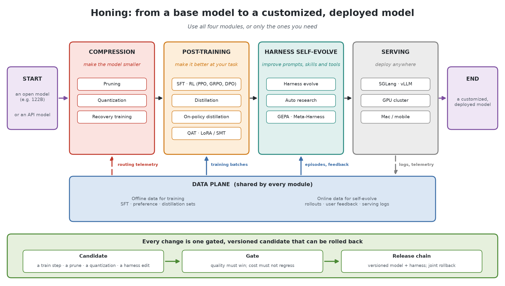
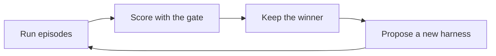
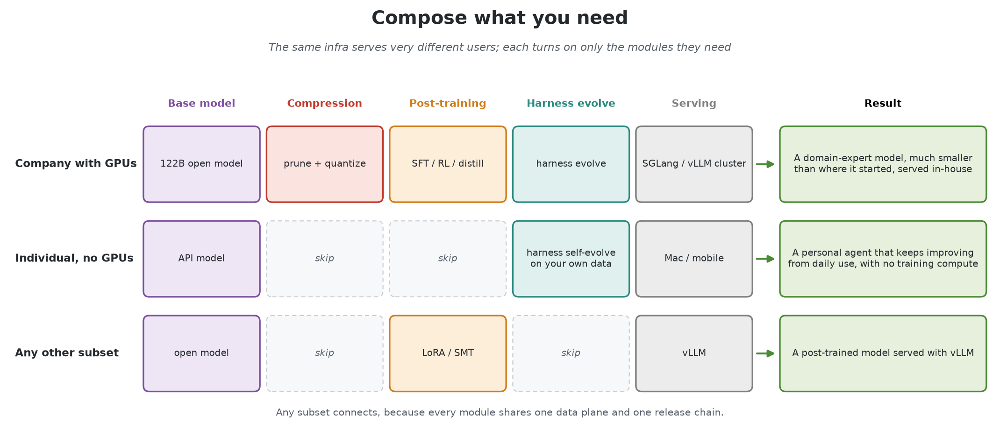
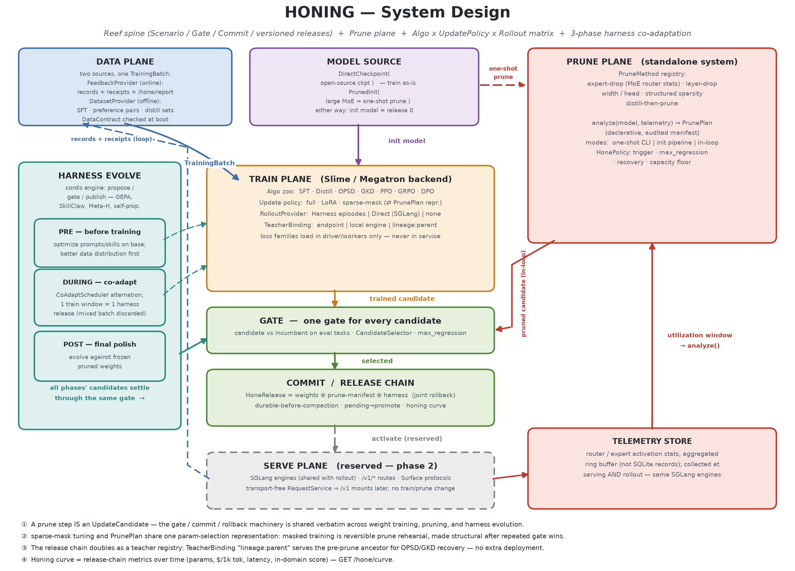

# Honing

One infra to customize, train, and deploy a model end to end. Use all of its
modules, or only the ones you need.

Honing starts from an open model (a 122B mixture-of-experts model, say) or from
a model behind an API, and ends with a model customized for one user or one
company and deployed where they run it. Four modules do the work:

| Module | What it does | Methods |
| --- | --- | --- |
| Compression | makes the model smaller | pruning, quantization, recovery training |
| Post-training | makes it better at your task | SFT, RL (PPO, GRPO, DPO), distillation, on-policy distillation, QAT, LoRA and SMT |
| Harness self-evolve | improves the prompts, skills, and tools around the model | harness evolve, auto research, GEPA, Meta-Harness |
| Serving | deploys the result | SGLang or vLLM on a GPU cluster, or a Mac or mobile app that calls the model |



A data plane underneath is shared by every module. Offline data (SFT,
preference, and distillation sets) becomes training batches. Online data
(rollouts, user feedback, and serving logs) drives harness self-evolve, and
serving telemetry such as per-expert routing counts tells compression what to
prune next.

Every change is one candidate: a training step, a prune, a quantization, or a
harness edit. One gate judges all of them. A change made for quality must beat
the release it would replace, and a change made for cost must not regress it.
An accepted candidate becomes a versioned release that records the model and
the harness together, so a rollback restores both.

## Scope

### Compression

Pruning scores importance from calibration data, weights, gradients, or serving
telemetry, then removes layers, experts, attention heads, or FFN dimensions.
Quantization exports low-bit serving weights and never modifies the
full-precision master weights. A cut is followed by a short post-training job
that recovers the quality it lost, and the gate judges the recovered model.

### Post-training

The algorithms are SFT, RL (PPO, GRPO, and DPO), distillation, and on-policy
distillation. A job updates all weights, LoRA adapters, or a sparse subset of
sub-matrices (SMT), and trains in bf16 or fp8. Quantization-aware training
shares one quantization scheme with serving, so the model is trained under
the scheme it is served with.

### Harness self-evolve

The harness is everything around the model: the system prompt, instructions,
skills, tools, and agent files. The loop runs episodes, scores them with the
same gate model updates pass, keeps the winner, and proposes the next harness.
Methods such as GEPA and Meta-Harness plug into the propose step.

The plan is to build this module by integrating a third-party harness
infrastructure, potentially [Reef](https://github.com/Human-Agent-Society/reef) or
[OpenHands](https://github.com/OpenHands/OpenHands). Each harness it proposes still
passes Honing's gate and lands in the release chain with the model it was evolved
for.



The loop needs no gradients. It learns from online data, so it also works with
a model behind an API and on a laptop or phone. It can run at three points:

| When | What it does |
| --- | --- |
| Before training | searches instructions and skills on the base model |
| During training | co-adapts with the weights, one harness per training window |
| After training | evolves against the exact weights that ship |

### Serving

SGLang and vLLM load the serving weights, quantized or not. The same engines
generate RL rollouts during training, so the model is trained on what it
serves. The target is a GPU cluster, or a Mac or mobile app that calls the
model through an API.

### Outside the scope

Honing starts from a trained model and does not pretrain one. It has no
training or inference engine of its own: [Slime](https://github.com/THUDM/slime)
trains, and SGLang and vLLM serve. Honing decides what runs next, checks each
move before it touches weights, and records the result.

## Compose what you need



A company with GPUs can use every module. It starts from a large open model,
prunes and quantizes it, post-trains it on its domain data, evolves the
harness, and serves the result in-house, ending with a domain expert much
smaller than the model it started from.

An individual with no GPUs can skip compression and post-training. They start
from an API model, let the harness self-evolve on their own data, and deploy on
a Mac or phone, which gives a personal agent that keeps improving from daily
use with no training compute.

Any subset in between works, for example post-training with LoRA or SMT and
serving with vLLM, because every module shares one data plane and one release
chain.

## Research it builds on

Three earlier projects of the author supply methods to the model modules:

| Project | Used for |
| --- | --- |
| Less is MoE | pruning |
| ExpertCondenser | MoE post-training |
| SMT | sparse fine-tuning |

## Status

The contracts every module is built against, the gate, the release chain, and
the campaign with its ordering rules are implemented. A walking skeleton runs
a full campaign (train, prune with recovery, quantize, evolve the harness,
roll back) on a CPU, with every module it does not yet implement replaced by a
fake. The first real workload is Red Alert 2, where a small decision model
plays matches and is gated and trained through Honing.

| Module | In code today | Next |
| --- | --- | --- |
| Gate and release chain | `honing/release`, `honing/campaign` | chain recovery after a crash |
| Compression | contracts, rules, and CPU fakes | an expert-drop editor on a small MoE |
| Post-training | Laya, Kev and NanoJev trainers: SFT and GRPO on typed decisions (`honing/backends/jev`); a Slime trainer for language models: SFT, on-policy (self-)distillation and GRPO (`honing/backends/slime`) | LoRA and parameter subsets through Slime; a local DPO trainer |
| Harness self-evolve | contracts, and the RA2 runner, grader, and harness (`honing/backends/ra2`) | GEPA ([#77](https://github.com/HectorHHZ/llm-honing/pull/77), in review) |
| Serving | an HTTP decision server for Laya, Kev, NanoJev and StartLux-Decision (0.8B, 4B, 27B), plus a [djev / DiffusionGemma bridge](integrations/djev/README.md) | managed SGLang and vLLM deployments |
| Data plane | the batch contracts, and RA2 and tank demonstration and rollout providers | dataset and feedback providers |

[`integrations/ra2/README.md`](integrations/ra2/README.md) runs the RA2 loop
end to end, and CI runs its dry run on every pull request.
[`scripts/e2e/`](scripts/e2e/README.md) runs one campaign through every plane
from a config that names each component, and checks a harness runner
(OpenHands, Reef, ...) or a trainer (Slime, ...) against what a campaign needs
from it, before it joins one. The implementation
steps are in [`system-design/system-design.md`](system-design/system-design.md#7-implementation-steps).

The [RICOCHET tank demo](integrations/tank-duel/README.md) offers two English sketch-style browser games: hull steering and automatic turret aiming. Both run locally without a model; set `HONING_URL` to enable model duels with live decision context and match exports. Classic is also a Honing task environment (`honing/backends/tank`): headless rounds against a planner opponent, a harness GEPA can rewrite, planner-teacher demonstrations for SFT and sampled rollouts for GRPO, and a CPU dry-run campaign CI runs on every pull request.

## System design



In code, the modules are planes on one release spine. The planes meet only
through the contracts in `honing/core`, which is what lets a user turn one on
without the others.

| Plane | Module | Owns |
| --- | --- | --- |
| Core | | the value types and protocols every plane is built against; imports only the standard library |
| Model Source | | the initial model: an open checkpoint, or a large model compressed first |
| Data | data plane | online feedback and offline datasets, behind one batch type |
| Train | post-training | algorithm, update policy, numerics, rollout source, and teacher as independent choices |
| Compression | compression | pruning (score, select, edit) and quantization; usable standalone |
| Harness Evolve | harness self-evolve | harness specs, episode runs, and evolution methods before, during, and after training |
| Campaign | | which move comes next, and the rules each move must pass before it touches weights |
| Gate and release | | one gate for every candidate, joint releases, the commit record, and rollback |
| Serve | serving | live traffic and artifact activation |

| Document | What it covers |
| --- | --- |
| [`system-design/system-design.md`](system-design/system-design.md) | subsystem contracts, the coupling model, the ordering rules, worked lifecycles, and the implementation steps |
| [`CONTRIBUTING.md`](CONTRIBUTING.md) | issue, commit, and pull request conventions; writing style; development setup |

## Development

```bash
uv venv && source .venv/bin/activate
uv pip install -e ".[dev]"
pre-commit install

pre-commit run --all-files
pytest
```

No GPU is needed for the test suite. The diagrams under `system-design/`
render with matplotlib alone:

```bash
uv run --no-project --with matplotlib python system-design/honing_scope.py
```

## License

[Apache-2.0](LICENSE)
