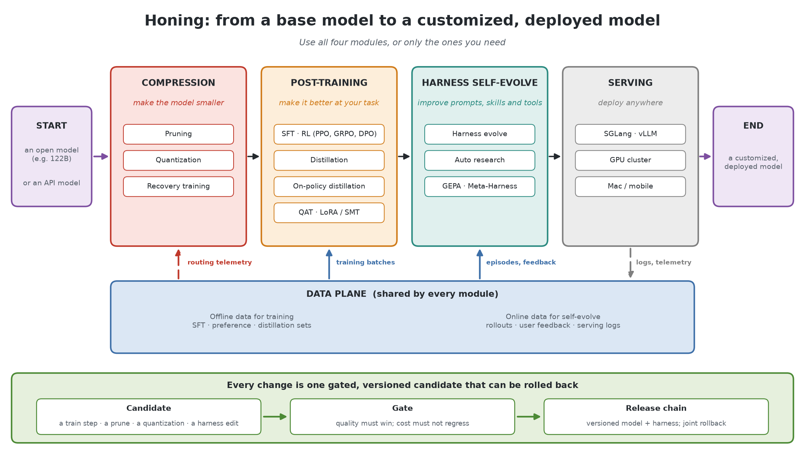

# Honing

Small decision models get good at a domain by playing in it, training on what
happened, and improving the harness around them. Two games show the loop. The
infra it runs on is being built here.

## Game scenarios

See [game runtime and adapter locations](integrations/README.md) for the
Python import paths, package contents and replay compatibility.

### Red Alert 2

https://github.com/user-attachments/assets/08a30342-5381-4f22-a8ae-6b438cff2994

We gave [NanoJev](https://huggingface.co/C-Tianyu/NanoJev), an open decision
model, a match of Red Alert 2 against the Supalosa bot. It sold its own
construction yard and lost at tick 140. After supervised training on a
teacher's matches, the same model builds a base, fights, and wins that
match-up. Laya, another family trained the same way, fields Kirov airships and
bombs the enemy base. The game and the opponent are the same in both halves of
the video; the weights are what changed.

[`integrations/ra2/`](integrations/ra2/README.md) has the headless engine adapter, the
match runner that records every request and command, supported model families
behind one decision server, and the SFT, GRPO, and GEPA integration. The video shows SFT; the RA2
controller does not yet sample actions for GRPO.

### Tank War

https://github.com/user-attachments/assets/9dca9289-bb7d-4b51-bd0b-8b896fabd42d

Two tanks in a maze fire shells that bounce off the walls, and a tank's own
shell can kill it. NanoJev drove all four versions in the video with the same
weights. Version 1 spun in circles. Version 2 found the fire button and shot
itself. Version 3 moves, aims, and fights. Version 4 dodges incoming shells and
wins. What changed between versions is the controller around the model: what
it is told about the game, which moves it may pick from, and the checks that
run its choice. The selected clips show controller changes; they are not
a release-gate result or a measured win-rate comparison.

The video then compares several models in one arena. In the local game, you
can take a seat against a configured model from the keyboard. Inference runs
on the model server; the browser needs no GPU.

[`integrations/tank-war/`](integrations/tank-war/README.md) has the browser
game, the arena, the headless rounds, and the controller changes that made
version 4.

### Griddly Spiders

[`integrations/griddly/`](integrations/griddly/README.md) adds native Griddly
Spiders: reach a gem while avoiding moving enemies. It supplies global
structured observations, native legal actions, isolated headless episodes,
verified replay, a typed decision runner/grader, rule-teacher SFT data and
sampled GRPO rollout data. Its global observation condition is named separately
from the original local-view task. A project-local launcher and English HTML
replay support local inspection. The runtime is optional; native HTTP contract
checks use a rule stand-in. A real NanoJev smoke episode reached the step limit
after choosing WAIT throughout. Real model training remains to be run.

### Craftax

[`integrations/craftax/`](integrations/craftax/README.md) adds the full Craftax
roguelike environment with its upstream pixel graphics, 43 native actions,
headless video recording, and verified action replay. It connects to the same
typed decision server and provides seeded tasks, an episode runner and a
grader for achievement goals. The initial task suite covers introductory
crafting in the full game; it does not measure full-game victory. Game runtime
dependencies are installed separately, and this integration does not train a
model or claim a model performance result.

### REA-Issac

[`integrations/rea_issac/`](integrations/rea_issac/README.md) adds an independent
Isaac-inspired room-combat simulation informed by REA resource analysis. It has
a real-time browser UI, deterministic action replay, a rule baseline, and the
same typed model interface with seeded tasks and boss-defeat grading. The CPU
engine needs only the Python standard library. It is not the original Isaac
engine and includes no original game assets. Model integration is checked with
a local protocol stand-in; no model performance result is claimed yet.

### Bring your own model

The games talk to a model through the same two HTTP routes the decision server
exposes, `GET /v1/health` and `POST /v1/decide`. Serve a model behind them and
it can play. [Connect a model](integrations/tank-war/README.md#connect-a-model)
in the Tank War README shows the request a seat sends, and
[Using a decision server](integrations/ra2/README.md#using-a-decision-server)
in the RA2 README runs a match against one.

A standalone [Hollow Knight imitation demo](integrations/hollow-knight/README.md)
connects a caller-supplied Unity Mono build to those same routes and records the
game's rendered frames. It is an input-adapter demo; it has no training or campaign runner.

Try the hosted human-versus-model game at **[play.honinglab.com](https://play.honinglab.com/play/)**.
We plan to open **Tank War Arena** for bring-your-own-model matches. Public
model submission is not open yet. The current hosted game uses a configured
opponent and an admission queue; local model integration is available now.

## Decision models supported

A decision model takes a state and a typed question with its options, and
returns a probability for every option in one forward pass, with no text
generated. Six families answer that request in Honing today, all behind one
HTTP decision server
([`honing/backends/jev/server.py`](honing/backends/jev/server.py)), so a game
or a trainer does not care which one it is talking to.

| Model | Base | Checkpoints | Trains in Honing |
| --- | --- | --- | --- |
| [NanoJev](https://huggingface.co/C-Tianyu/NanoJev) | Qwen3-0.6B, with a scalar head and a set attention head over candidate paths | `nanojev` | SFT, GRPO, direction edit |
| [Laya](https://huggingface.co/convaiinnovations/laya) | its own encoder and option head | `english`, `typed-decisions` | SFT, GRPO |
| [Kev](https://github.com/jaredpalmer/kev) | Qwen3.5-0.8B-Base and Qwen3.5-4B-Base, with a LoRA adapter and a pointer head | `kev-0.8b`, `kev-4b` | SFT, GRPO |
| [StartLux-Decision](https://github.com/StartLuxLabs/Startlux-Decision) | Qwen3.5, dense; the answer is read from the next-token logits of the option letters | `startlux-0.8b`, `startlux-4b`, `startlux-27b` | serving only |
| DiffusionGemma through [djev](integrations/djev/README.md) | `google/diffusiongemma-26B-A4B-it` on a remote djev server | the operator's deployment | serving only |
| [Nimble-v4-max](integrations/ra2/README.md#using-nimble-v4-max) | Bespoke decision model | `nimble-v4-max` | serving only |

What runs each part today, what each method edits, and what it learns from:

| | Method | What it edits | What it learns from |
| --- | --- | --- | --- |
| Training | SFT, in the local trainers for Laya, Kev, and NanoJev, and in [Slime](https://github.com/THUDM/slime) for language models | the weights | a teacher's pick at each decision point |
| | GRPO, in the same trainers | the weights | the result of the model's own sampled matches |
| | Direction edit, for NanoJev ([report](integrations/tank-war/direction-edit.md)) | the decision head, 1,024 weights, no gradients | the head's own inputs on a teacher's decisions |
| | On-policy distillation, in Slime for language models | the weights | a teacher's log-probabilities on the student's own samples |
| Inference | The decision server: one request format for the six families above | | |
| | [djev](integrations/djev/README.md): DiffusionGemma on a remote server | | |
| | SGLang: any Hugging Face checkpoint, in review ([#109](https://github.com/HectorHHZ/llm-honing/pull/109)) | | |
| Harness self-evolve | GEPA, with its proposer reaching any chat model through litellm | the question text, instructions, and skills | the match result and the grader's notes |
| | Auto research: an engineer proposes a change, matches decide | the controller around the model: context, admissible moves, checks | matches between the proposed controller and the current one |
| | Meta-Harness, in review ([#105](https://github.com/HectorHHZ/llm-honing/pull/105)) | | |

## How a model keeps learning

[Weight modification](system-design/weight-edit.md) also uses the Trainer interface:
named tensor addition, scaling and replacement, with the same candidate gate and
release records. NanoJev's direction edit uses this shared checkpoint writer.

A released model plays, and the records of its play feed the training and
harness changes in the table above.

Every change is one candidate. Training candidates must win more paired
validation comparisons than they lose under the default selector. GEPA uses
its own selector: a strictly higher validation mean than its served candidate.
An accepted candidate becomes a versioned release that records the weights and the
harness together, so a rollback restores both. The loop then starts again from
the new release.

The infra for this loop is what this repository builds, and it is not finished.
Today it has the decision server, the SFT and GRPO trainers for Laya, Kev, and
NanoJev, GEPA for the harness, the gate, the release chain, and both games as
task environments. CI runs each game through the whole loop with stand-in
models on every pull request. Each piece has run on a GPU on its own; a
campaign that trains real weights inside the loop is next.

## Where this goes: decision models as tools for an agent

An LLM agent reasons through a long trajectory for every decision, including
the routine ones it has made many times before. A decision model trained on
that domain answers those in one forward pass. We want the agent to call its
trained decision models as tools: the routine parts come back fast, and the
agent spends its longer reasoning on the parts that need it. The games are the
first domains. The loop above is how a decision model gets good enough to be
called, and stays good as the domain shifts.

## Honing, the infra underneath

Honing is the infra the loop runs on, and the games use the part of it that
exists. Its scope is wider: one infra that takes an open model, or a model
behind an API, to a model customized for one user or company and deployed
where they run it, with the user turning on only the modules they need.

| Module | What it does | Methods |
| --- | --- | --- |
| Compression | makes the model smaller | pruning, quantization, recovery training |
| Post-training | makes it better at your task | SFT, RL (PPO, GRPO, DPO), distillation, on-policy distillation, QAT, LoRA and SMT |
| Harness self-evolve | improves the prompts, skills, and tools around the model | GEPA, Meta-Harness, auto research |
| Serving | deploys the result | SGLang or vLLM on a GPU cluster, or a Mac or mobile app that calls the model |



A data plane underneath is shared by every module. Offline data becomes
training batches, online data (rollouts, feedback, serving logs) drives harness
self-evolve, and serving telemetry tells compression what to prune. Every
change is one candidate: a training step, a prune, a quantization, or a harness
edit. One gate judges all of them, and an accepted one settles into one release
chain. The decision-model loop above is this design with post-training, harness
self-evolve, and serving turned on and compression turned off.

Beyond that loop, the code today has a Slime trainer for language models (SFT,
on-policy distillation, GRPO), a GEPA that rewrites the instructions and skills
of any agent, task suites with a command grader, and a pipeline that assembles
a campaign from a JSON config and checks a new runner or trainer against what a
campaign needs from it ([`scripts/e2e/`](scripts/e2e/README.md)). Compression
is contracts and fakes. Honing does not pretrain a model and has no engine of
its own: [Slime](https://github.com/THUDM/slime) trains, and SGLang and vLLM
serve.

The planes behind the modules, the contracts they meet through, the rules every
move passes before it touches weights, and the implementation steps are in
[`system-design/`](system-design/README.md).

The local decision server also supports [Nimble-v4-max](integrations/ra2/README.md#using-nimble-v4-max), with pinned source and checkpoint verification.

## Development

```bash
uv venv && source .venv/bin/activate
uv pip install -e ".[dev]"
pre-commit install

pre-commit run --all-files
pytest
```

No GPU is needed for the test suite. Conventions for issues, commits, pull
requests, and prose are in [`CONTRIBUTING.md`](CONTRIBUTING.md).

## License

[Apache-2.0](LICENSE)
