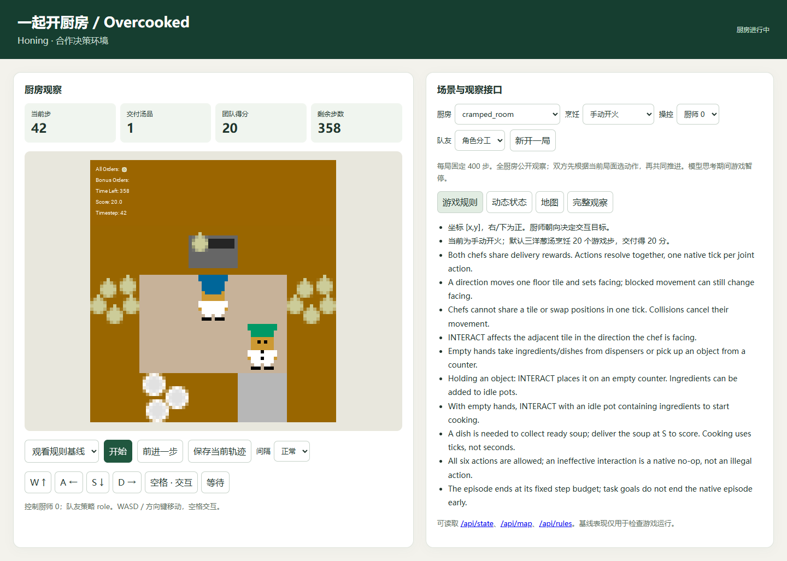

# Overcooked-AI

Native [Overcooked-AI](https://github.com/HumanCompatibleAI/overcooked_ai) as a
cooperative Honing environment. The pinned upstream engine owns movement,
collisions, interactions, recipes and rewards. Its own sprites render every
GUI frame. This directory contains the complete integration: runtime wrapper,
browser observer, typed model client, recordings, replay, tasks and Honing
runner/grader adapters. No new code lives in `honing/`.

最新真实模型验收见 [validation/pilot-v1.md](validation/pilot-v1.md)：已复用本地
NanoJev，完成 9 局模型评估、一次 SFT 及验证选择。SFT 验证成绩持平被拒绝，
GUI 继续使用原始模型。本轮未测得超过固定等待对照的最终分数收益。

## 本机验收

在仓库根目录的 PowerShell 运行：

```powershell
.\integrations\overcooked\run.ps1 -Mode play -Open
```

浏览器打开 <http://127.0.0.1:4185/>。默认是 `cramped_room`，400 个游戏步，
手动开火规则。选择“观看规则基线”后点击“开始”，可观看两名厨师取料、
烹饪、装盘和交付；“暂停”和“前进一步”用于检查每个动作。

- 选择“人工单步”：WASD / 方向键移动，空格与面前的设施交互，也可点击按钮。
- “动态状态”“地图”“完整观察”显示与画面对应的原生数据。
- 可切换五个厨房、操控厨师、队友策略，以及手动／自动开火，再点击“新开一局”。
- “保存当前轨迹”显示导出目录。部分轨迹也可回放，但不能作为完成的评估成绩。
- Ctrl+C 停止前台服务。端口冲突时传 `-Port 4186`。

The GUI serves official native PNGs. It does not implement a second game engine
in JavaScript. A frame hash ties the displayed image to its public state;
reading the GUI, map, rules or image never advances simulation time.

## Installation and local environment

The author machine's D: conda base was Python 3.13 and `rag_env` was Python 3.11.
The upstream revision declares Python 3.10, so a separate conda prefix is used:
`integrations/overcooked/.venv`. Existing environments are left intact.

```powershell
.\integrations\overcooked\setup.ps1
# If conda is installed elsewhere:
.\integrations\overcooked\setup.ps1 -Conda 'D:\path\to\conda.exe'
```

The script downloads the source revision in `pins.json`, checks out its native
package with Git sparse checkout, installs `requirements-lock.txt`, then checks
the native code/resource hash. Environment, downloads, pip/conda caches and
installation temporary files stay in this directory on D:. These directories
are ignored by Git. `requirements.txt` lists direct dependencies;
`requirements-lock.txt` records the Windows Python 3.10 acceptance environment.

The native package is installed editable with `--no-deps --no-build-isolation`.
No Ray, TensorFlow, upstream web server or pretrained agent is needed.
The source/resources are unchanged. The upstream environment may create its
own motion-planner cache under `upstream/`; those generated files are ignored.

This integration is currently a source-checkout integration, like OfficeQA.
The root wheel's package list is unchanged. The verified platform is Windows
x86-64; other platforms need separate dependency and rendering validation.

## Headless episodes and replay

```powershell
.\integrations\overcooked\run.ps1 -Mode demo
```

The last JSON line gives a new directory under `integrations/overcooked/runs/`.
It records both chefs' actions and verifies the complete native trajectory.
An explicit `-RunDir` must name a new directory; existing runs are not overwritten.

```powershell
.\integrations\overcooked\run.ps1 -Mode replay -RunDir 'D:\path\to\run' -Open
.\integrations\overcooked\run.ps1 -Mode verify -RunDir 'D:\path\to\run'
```

The replay GUI verifies the run first and has a seek slider. Verification
creates a fresh native engine and checks every frame, action, score, event,
runtime identity and final result. Model runs additionally reconstruct each
exact input from the saved harness and check the response and executed choice.
It makes no model calls. It requires the recorded integration source and native
runtime; retain the code revision with recordings. Verification does not modify
the recording. Browser rendering alone is not replay verification.

| File | Contents |
|---|---|
| `manifest.json` | Scenario, engine/resources/dependency identity, adapter source hash, controller and policy/harness identity |
| `steps.jsonl` | Initial frame and every native joint action/result, including both chefs |
| `decisions.jsonl` | Pre-action frame identity, exact model request/reply when applicable, choice and latency |
| `harness/files.json` | Exact delivered instruction/settings files for match runs |
| `result.json` | Steps, deliveries, native reward, completion, bounded task grade and final frame hash |
| `first-frame.png`, `last-frame.png` | Native stills for CLI matches, unless disabled |
| `error.json` | Failure; failed episodes have no completed result |

Interactive GUI recordings are labeled `interactive`, even when a model is
selected. They are demonstrations, and the grader refuses them. Model request
and response are retained separately in these UI traces. Export freezes a copy
of the current trajectory; the live game can continue independently.

## Map, state, rules and controls

The protocol is `overcooked-full-kitchen-v1`: the entire kitchen is public.
Neither chef sees the teammate's pending action. Coordinates are `[x,y]`, with
upper-left origin, x right and y down. Terrain is indexed as `terrain[y][x]`.
The model is explicitly told this information condition.

Python imports need only the standard library until an engine is constructed:

```python
from integrations.overcooked.engine import Engine, Scenario

with Engine(Scenario(layout="cramped_room", max_steps=400)) as game:
    frame = game.observe()       # Read-only JSON snapshot; no clock advancement.
    kitchen = game.game_map()    # Terrain, legend, dimensions and walkable cells.
    rules = game.rules()         # Resolved recipes, times, values and dynamics.
    png = game.png()             # Official renderer, offscreen PNG bytes.
    frame = game.step(["NORTH", "STAY"])  # Chef 0, chef 1; exactly one native tick.
```

`reset()` resets that instance to the layout's standard start. `close()` is
idempotent; reads/steps on a closed engine fail. A finished engine rejects more
steps until reset. Use separate processes for isolated evaluation episodes.

| Frame field | Meaning |
|---|---|
| `map` | Layout, terrain, dimensions, legend, walkable cells and start positions |
| `state.players` | Position, orientation and held object for each chef |
| `state.objects` | Objects on counters/in pots, including ingredients and cooking progress |
| `state.all_orders`, `state.bonus_orders` | Allowed and bonus recipes |
| `pots` | Pot positions grouped by empty, ingredient count, cooking and ready |
| `rules` | Resolved recipes, cook ticks, rewards, dynamics flag and action semantics |
| `score`, `deliveries`, `reward`, `events` | Native team reward, rewarded delivery count and latest transition diagnostics |
| `delivery_attempts` | All native delivery events, including disallowed recipes that earn zero |
| `step`, `max_steps`, `status` | Native tick and adapter budget |
| `terminated`, `truncated` | Budget expiry is truncation, not native victory |
| `legal_actions` | All six native options while running; empty at the budget |
| `frame_hash` | SHA-256 of the canonical JSON for all other frame fields |

The native actions are `NORTH`, `SOUTH`, `EAST`, `WEST`, `STAY`, `INTERACT`.
Blocked moves may still rotate the chef. An ineffective interaction is a legal
native no-op; the adapter does not mask it or replace the chosen action.

`old_dynamics=False` requires an empty-handed interaction to start an idle pot;
`True` starts a three-ingredient pot automatically. Current selectable layouts
all use three-onion recipes. All resolved cook times are game ticks, not seconds.
The fixed budget always runs to its end; reaching the delivery target does not
stop the episode early. Inference waits do not advance game time.

| Local GUI route | Behavior |
|---|---|
| `GET /api/state` | Current frame, scenario and UI status |
| `GET /api/map` | Public kitchen geometry |
| `GET /api/rules` | Rules and recipe configuration |
| `GET /frame.png?hash=HASH` | Native rendering of the matching recent frame |
| `POST /api/step` | One human/baseline/model step, or seek in replay mode |
| `POST /api/reset` | Save the previous session and start the selected scenario |
| `POST /api/export` | Export a stable trajectory snapshot to a new directory |

Example command body:

```json
{"policy":"human","action":"INTERACT","frame_hash":"CURRENT_FRAME_HASH"}
```

The HTTP server binds only to `127.0.0.1`, rejects stale observations and
cross-origin browser commands, and serializes state changes. One tab should
control a session. A pending model request leaves observation reads available
while simulation stays frozen. These routes are local tools, not hosted APIs.

## Connect a decision model

Start an existing Honing decision server separately, then:

```powershell
# GUI model observation/control:
.\integrations\overcooked\run.ps1 -Mode play -DecisionServer 'http://127.0.0.1:8080' -Open
# Recorded model episode and native verification:
.\integrations\overcooked\run.ps1 -Mode model -DecisionServer 'http://127.0.0.1:8080'
```

The routes are `GET /v1/health` and `POST /v1/decide`, using the existing
`id`, `parts`, `questions` envelope. There is one six-option `action` question.
Input contains public map, current state, resolved rules, budget and recent
joint actions. Candidate responses must preserve the complete context and
return finite normalized probabilities and their argmax. Invalid replies stop
the run; no rule action substitutes for the model. `HONING_TOKEN` optionally
supplies a Bearer token and is not recorded. Select a server context limit
large enough for the entire request; silent truncation is rejected.

For sampled trajectories, use the module CLI:

```powershell
& .\integrations\overcooked\.venv\python.exe -m integrations.overcooked.match `
  --policy model --decision-server http://127.0.0.1:8080 --sample --policy-seed 17 --verify
```

The adapter preserves the reply distribution and actual sampled action. The
pilot below runs real NanoJev inference and one SFT candidate through existing
Honing components. Protocol unit tests still use an explicitly labeled stand-in.
GRPO rollouts can be recorded, but a GRPO campaign is not implemented here.

## Honing tasks and grading

`adapter.py` provides `OvercookedEpisodeRunner` and `OvercookedGrader` using the
unchanged core protocols. The runner starts a separate game-environment process.
The grader runs native replay in that environment, then requires a completed
model evaluation with the requested task, policy checksum and harness identity.
The score is `native_score / (native_score + score_scale)`, with a fixed
`score_scale=40` for the benchmark. This strictly preserves native score order:
0, 20, 40 and 200 native points become 0, 1/3, 1/2 and 5/6. Two deliveries remain
a diagnostic success target; reaching it neither caps the grade nor ends play.
Only deliveries earning positive native reward count toward the target. The
native delivery event also fires for disallowed recipes, so raw event counts
must not be used as task credit.
The server operator remains responsible for the checkpoint it actually serves.

`e2e.py` exposes `tasks`, `harness_seed`, `episode_runner` and `grader` factories
for the existing component loader. The surrounding deployment supplies
`endpoints` with runtime `jev_decision`. Factory paths start with
`integrations.overcooked.e2e:`. No core changes or model-server startup are needed.

The harness can change action instructions, notes and history length (0..16).
It cannot change layout, player seat, teammate, rules, budget or scoring; those
belong to `Scenario` and `tasks/suite.jsonl`.

The initial six-task smoke suite separates layouts:

| Split | Layout | Teammates |
|---|---|---|
| train | cramped_room | role, solo |
| val | asymmetric_advantages | role, solo |
| heldout | coordination_ring | role, solo |

`role` is a public-state onion-soup heuristic with player 0 supplying and
player 1 preferentially serving. `solo` is a greedy independent heuristic;
`stay` is a passive partner. These are distinct baselines, not trained agents
or optimal teachers. They may stall on difficult kitchens, especially layouts
requiring counter handoffs. Their behavior must not be reported as model skill.

Disjoint kitchen layouts provide a starting point for generalization checks.
This small suite does not establish cross-game or unseen-partner generalization.
This checks transfer between kitchen layouts within one game; it does not
measure transfer between games.

## Cached NanoJev and a bounded real pilot

The previously downloaded checkpoint is inside the D: hosted Ubuntu WSL disk,
not a missing Windows weights directory. The verified runtime is:

| Item | Location / identity |
|---|---|
| WSL distribution / Python | Ubuntu, `/opt/honing/venvs/nanojev/bin/python`, Python 3.12.16 |
| Native model source | `/opt/honing/deps/nanojev`, `76fdfc9ecdca45a9bcef17991a07d3041a87685a` |
| Cached checkpoint | `C-Tianyu/NanoJev`, revision `047b927b30882a1138fc504821b82ac145a4b81a` |
| Weights SHA-256 | `f68c47d66998231b86b7e91b4ed5e82ae23acf104c8b7cd6d165c3ac7b7ffe1b` |
| Native cache root | `/opt/honing/cache/huggingface` |

`model_env.py` reuses the existing loader and Tank/RA2 NanoJev pins; it checks
the pinned source and cached weights, and sets offline mode. The Windows game
environment stays separate. Nothing is installed into either existing runtime.
The Linux runtime is physically in `D:\ubuntu\wsl\Ubuntu\ext4.vhdx`.
The verified local discovery is retained in
[validation/checkpoint-discovery.json](validation/checkpoint-discovery.json).

```powershell
# Check the cached source/checkpoint and write .cache/model-discovery.json:
.\integrations\overcooked\model.ps1 -Mode inspect
# Foreground GPU service; keep this terminal running:
.\integrations\overcooked\model.ps1 -Mode serve
# Another terminal, GUI with the real model enabled:
.\integrations\overcooked\run.ps1 -Mode play -DecisionServer http://127.0.0.1:8803 -Open
# Only stops a matching Overcooked launcher on this port:
.\integrations\overcooked\model.ps1 -Mode stop
```

The formal suite `tasks/benchmark-v1.jsonl` contains 27 conditions, with both
controlled seats, disjoint kitchen layouts, and a heldout-only `solo_slow`
partner (greedy once per three ticks, otherwise waiting). The frozen
`experiments/pilot-v1.json` selects a smaller pilot: three train conditions,
two validation conditions, and two heldout conditions. Every episode has 400
joint-action ticks, reference inference, argmax decisions and no fallback.
One episode per condition does not support a broad generalization claim.

```powershell
& .\integrations\overcooked\.venv\python.exe -m integrations.overcooked.experiments `
  --split train --policy model --out integrations/overcooked/runs/my-base-train `
  --expected-checksum f68c47d66998231b86b7e91b4ed5e82ae23acf104c8b7cd6d165c3ac7b7ffe1b
```

`experiments.py` uses the existing `run_graded`, runner and grader. Its summary
retains raw score, deliveries, first delivery step, action counts, stationary
streaks, token truncations and decision latency. Rule runs use `--policy baseline`
and are never represented as model results. The initial real train baseline
scored zero in all three conditions; the model predominantly chose `STAY`.

Teacher matches use explicit `--policy teacher` and retain the exact same typed
requests a model sees. `data.py` requires native replay and a matching train task
before producing labels; it refuses validation/heldout kitchen demonstrations.
The pilot uses 184 action-balanced fit examples and 48 internal validation
examples from separate train-map episodes, without using heldout data.

`train.py` calls the existing `NanoJevTrainer` for two SFT epochs, bf16 forward,
one question per batch, seed 7, head learning rate 1e-4. Only parameters matching
`^(norm|scalar|set_)` train, keeping the backbone frozen on the 8 GB GPU. The
trainer selects its best internal-validation checkpoint. Losses for every
forward, epoch metrics, dataset hash, actual trainable parameters, and checkpoint
manifest remain under the new training directory. W&B cloud logging is not
configured; equivalent loss/epoch metrics are retained locally. The base weights
are never overwritten. Stop the inference server before training to release its
exclusive GPU lock.

The completed candidate trained 200,578 head parameters and reduced internal
validation cross-entropy from 1.90385 to 1.84120 (20.83% action accuracy). This
does not establish better game play. Its checksum is
`b67988c346f8816be40bb9f1e6e1a2d310220ccc161c6867759d23cf847d72da`.
The first attempt failed during the second checkpoint save because cached
tokenizer files carried read-only bits onto NTFS. The integration's training
wrapper now clears those bits only inside its own checkpoint directory. A
same-configuration retry reproduced all 512 forward losses and the final
weights exactly. Its successful receipt is under `runs/pilot-v1/training-retry/`;
the failed attempt is retained under `runs/pilot-v1/training/`.
Tracked metadata and every forward loss are attached as
[validation/training-v1.json](validation/training-v1.json) and
[validation/training-loss-v1.jsonl](validation/training-loss-v1.jsonl).
W&B is absent from the reused model environment, so no cloud log is claimed.

```powershell
& .\integrations\overcooked\.venv\python.exe -m integrations.overcooked.data `
  --out integrations/overcooked/runs/my-teachers
wsl.exe -d Ubuntu --exec /opt/honing/venvs/nanojev/bin/python `
  /mnt/d/llm-honing/integrations/overcooked/train.py `
  --dataset /mnt/d/llm-honing/integrations/overcooked/runs/pilot-v1/teachers/dataset.json `
  --out /mnt/d/llm-honing/integrations/overcooked/runs/my-training
# Load a completed candidate using its checkpoint.json, not config.json:
.\integrations\overcooked\model.ps1 -CheckpointManifest 'D:\path\to\train-xxx\checkpoint.json'
```

`select_candidate.py` compares the two fixed validation tasks using Honing's
`WinLossSelector`. It accepts only more paired wins than losses, including
rejecting an all-tie candidate. Heldout runs happen after that decision, without
further tuning. This is a local pilot using the core trainer/evaluator/selector;
it does not publish into the shared release registry or run a GEPA/GRPO campaign.

With the game environment installed and training complete, the full validation
and selected-policy heldout sequence can be run from Windows with:

```powershell
& .\integrations\overcooked\.venv\python.exe -m integrations.overcooked.evaluate_pilot `
  --training integrations/overcooked/runs/pilot-v1/training-retry/receipt.json
```

It switches the dedicated WSL service between exact checkpoint checksums and
leaves the selected model available on port 8803. Completed stages can be reused;
partial stages are retained and require a fresh output root via `--out`.

Recordings now use `overcooked-match-v2` with the grading version stamped in the
manifest. Earlier first-stage v1 acceptance remains historical; its source was
saved to `runs/source-v1-1e1d4c440a30.zip` before the scoring change. Replay
intentionally refuses a source/version mismatch rather than silently rescoring.

## Checks

First-stage acceptance is recorded in [validation/acceptance.json](validation/acceptance.json).
The first-stage 28 integration tests passed, the setup script and browser acceptance passed,
and a 400-tick native baseline delivered 10 rewarded soups for 200 points with
every frame passing replay. These are baseline/interface results, not model
performance. The combined regression run passed 114 tests and failed two
unchanged Windows path-separator assertions in `tests/contracts/test_boundaries.py`
(`litellm` and `wandb` importer paths). No existing repository file was changed.



```powershell
.\integrations\overcooked\run.ps1 -Mode test
& .\integrations\overcooked\.venv\python.exe -m ruff check integrations/overcooked
```

Tests exercise the actual native engine: cooking under both dynamics, delivery
events, all five selectable kitchens, official rendering, observational purity,
strict HTTP decisions, sampled trajectories, model failure without fallback,
tamper rejection, replay seek, and runner/grader execution. Model protocol tests
use a local stand-in and do not download or train weights.

Optional browser acceptance, using an installed Edge (or `OVERCOOKED_BROWSER`):

```powershell
npm install --prefix integrations/overcooked/.cache/browser playwright
node integrations/overcooked/tests/browser_check.cjs
# After a completed real pilot, also test actual model calls in the GUI:
node integrations/overcooked/tests/real_model_browser.cjs
```

It starts an isolated ephemeral-port service and checks real PNG display,
autoplay delivery, pause, keyboard actions, state/map/rules panels, export,
dynamics/layout changes and mobile layout. It closes its own browser/service.
Screenshots and receipts are in `.cache/browser-qa/`.

Upstream source and assets retain their MIT license in the separately downloaded
`upstream/LICENSE`. Nothing from the commercial Overcooked installation is needed.
