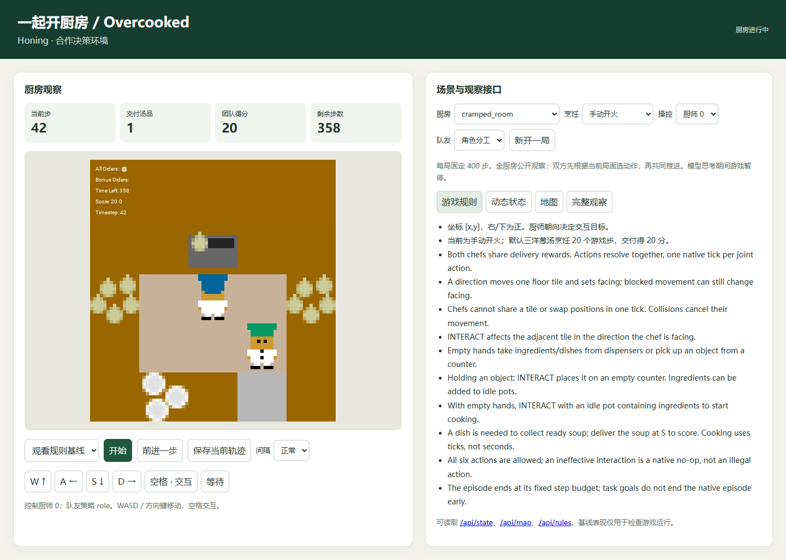

# Overcooked 真实 System0 小试验收

本地日期：2026-11-12。完整机器记录见 [pilot-v1.json](pilot-v1.json)。

本轮已完成游戏与 GUI 验收、正式评分调整、真实 NanoJev 基线、一次规则示范 SFT、验证选择及留出测试。模型调用通路可用，但本轮尚未测得超过固定等待对照的游戏收益。

## 找到并复用了已有 checkpoint

之前下载的模型保存在 Ubuntu WSL 内，虚拟磁盘位于 `D:\ubuntu\wsl\Ubuntu\ext4.vhdx`。

- 模型：`C-Tianyu/NanoJev`，版本 `047b927b30882a1138fc504821b82ac145a4b81a`。
- Linux 缓存：`/opt/honing/cache/huggingface/hub/models--C-Tianyu--NanoJev/snapshots/047b927b30882a1138fc504821b82ac145a4b81a`。
- 原始权重 SHA：`f68c47d66998231b86b7e91b4ed5e82ae23acf104c8b7cd6d165c3ac7b7ffe1b`。
- 复用 `/opt/honing/venvs/nanojev/bin/python`，Python 3.12.16，以及现有 Honing NanoJev 加载器和 Tank/RA2 的固定版本配置。
- 源码版本、缓存权重和 CUDA 均已校验。本轮没有重新下载模型，没有覆盖原始权重或修改已有环境。

发现记录：[checkpoint-discovery.json](checkpoint-discovery.json)。Windows 游戏仍使用独立的 `integrations/overcooked/.venv` Python 3.10 环境。

## 评估设置

模型控制厨师 0，另一名厨师使用固定规则策略。两人根据同一帧选择动作，再共同推进一个原生游戏步。每局完整运行 400 步，推理等待不消耗游戏步。

原生总分是主要结果。Honing 的有界评分为 `原生总分 / (原生总分 + 40)`，不会在两次交付后封顶。旧版验收保留为历史记录，新轨迹使用 `overcooked-match-v2`。

完整任务文件定义 27 个条件，包含两种操控席位；本轮真实模型小试实际执行 9 局，仅使用厨师 0。训练、验证、测试厨房分别为 `cramped_room`、`asymmetric_advantages`、`coordination_ring`。测试中的 `solo_slow` 队友每三步执行一次贪心策略，其余两步等待，未出现在训练与验证条件中。

协议在基线运行前固定，见 [pilot-v1.json 协议](../experiments/pilot-v1.json)。没有根据测试结果调整候选或评分。

## 原生分数

| 阶段 / 厨房 | 队友 | 原始模型 | SFT 候选 | 规则策略控制厨师 0 |
|---|---|---:|---:|---:|
| train / cramped_room | 分工 role | 0 | 未评估 | 200 |
| train / cramped_room | 贪心 solo | 0 | 未评估 | 40 |
| train / cramped_room | 等待 stay | 0 | 未评估 | 160 |
| val / asymmetric_advantages | 分工 role | 0 | 0 | 400 |
| val / asymmetric_advantages | 贪心 solo | 180 | 180 | 320 |
| heldout / coordination_ring | 分工 role | 0 | 未评估 | 180 |
| heldout / coordination_ring | 低频贪心 solo_slow | 40 | 未评估 | 120 |

每局均完成原生回放校验，所有正式模型回合的上下文截断数为 0。候选在验证集被拒绝后，没有运行其测试集成绩。规则策略是本集成的启发式对照，不能当作最优上界。

## SFT 与选择结果

使用已有 `NanoJevTrainer`，训练 2 轮，seed 7，每批一个问题，bf16 前向，决策头学习率 `1e-4`。冻结主干，只更新 200,578 个头部参数。184 条拟合示范和 48 条内部校验示范均来自训练厨房的不同回合；不使用验证或测试厨房示范。

内部校验交叉熵从 **1.90385** 降至 **1.84120**，最终动作准确率 **20.83%**。候选 SHA 为 `b67988c346f8816be40bb9f1e6e1a2d310220ccc161c6867759d23cf847d72da`。

真实验证分数没有提高。现有 `WinLossSelector` 给出 **0 胜、0 负、2 平，拒绝候选**，本地服务继续使用原始 checkpoint；没有向共享 release registry 发布模型。

第一次训练完成了两轮计算，但第二次保存时因 tokenizer 只读属性导致 NTFS 覆盖失败。修复仅清理当前 checkpoint 输出目录的只读属性；同配置重跑的全部 512 次前向损失与最终权重 SHA 完全一致。失败目录和成功目录都已保留。

详见 [training-v1.json](training-v1.json) 和逐次损失 [training-loss-v1.jsonl](training-loss-v1.jsonl)。已有模型环境未安装 W&B，本轮以本地文件保留相同指标和配置，没有云端日志。

## 团队分数与模型贡献

原始模型在两个验证回合里都选择了 400 次 `STAY`，但贪心队友仍取得了 180 分。因此，该局高分不能作为模型会做饭的证据。候选在验证分工局仍全程等待，贪心局为 394 次等待、4 次交互和 2 次向北。

选择结束后额外运行了“厨师 0 固定等待”的诊断对照，同样完成原生回放和队友动作校验：

| 条件 | 选中模型 | 固定 STAY 对照 | 分数差 |
|---|---:|---:|---:|
| 验证 / role | 0 | 0 | 0 |
| 验证 / solo | 180 | 180 | 0 |
| 测试 / role | 0 | 0 | 0 |
| 测试 / solo_slow | 40 | 40 | 0 |

这是事后诊断，没有用于训练、选择或改变正式评分。测试低频贪心局中模型有 78 次交互、322 次等待；相同最终分数并不能证明各步动作没有影响，但本轮没有测得超过固定等待对照的最终分数收益。

后续能力报告应同时保留团队原生分数、固定等待对照、动作轨迹及多地图/队友结果。本轮覆盖同游戏的地图与队友变化；跨游戏泛化和对 Tank/Griddly 的能力保留仍需独立评估。

## GUI 与检查

验收入口：<http://127.0.0.1:4185/>。选择“观察模型”，再点击“开始”或“前进一步”。它连接本地真实 NanoJev 服务 <http://127.0.0.1:8803/>。原 GUI 轨迹已导出保留。

- 36 项 Overcooked 集成测试通过；ruff、black 检查通过。
- 已有 Linux 核心合同与 walking-skeleton：67 项通过，8 项因缺少 Slime 上游组件跳过，无失败。
- Windows 组合回归中已有两项路径分隔符断言失败；完整合同收集还受 `fcntl` 平台限制影响。相关原文件未修改。
- 通用浏览器验收通过：原生 PNG、操作/暂停、地图/状态/规则、导出、布局切换、移动尺寸及回放。
- 真实模型浏览器验收通过：校验服务 checkpoint、完成 5 次真实模型动作、导出并通过原生回放；该交互烟测不计入正式游戏成绩。

运行与复现命令见 [README](../README.md)。所有新增源代码和验收资料均在 `integrations/overcooked/`；模型、环境、缓存和完整轨迹保存在其忽略目录或已有的 D 盘 WSL 中。
