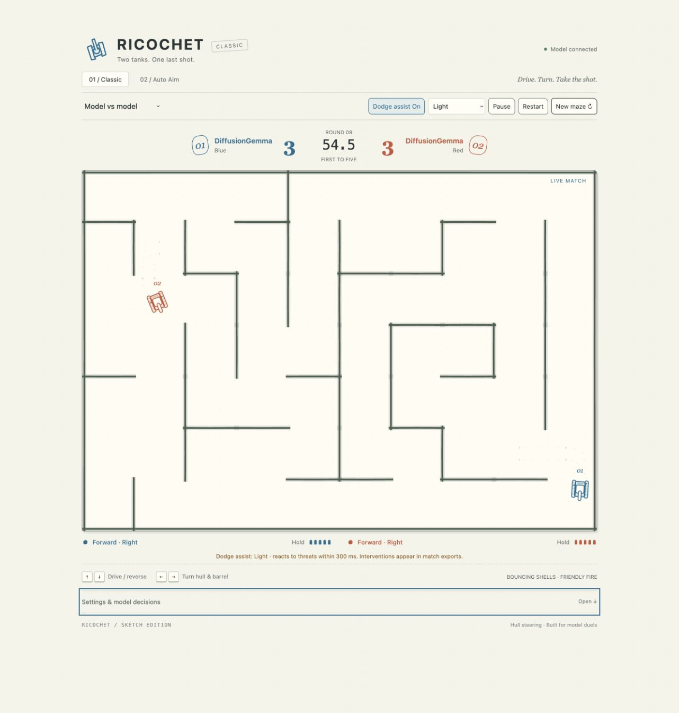
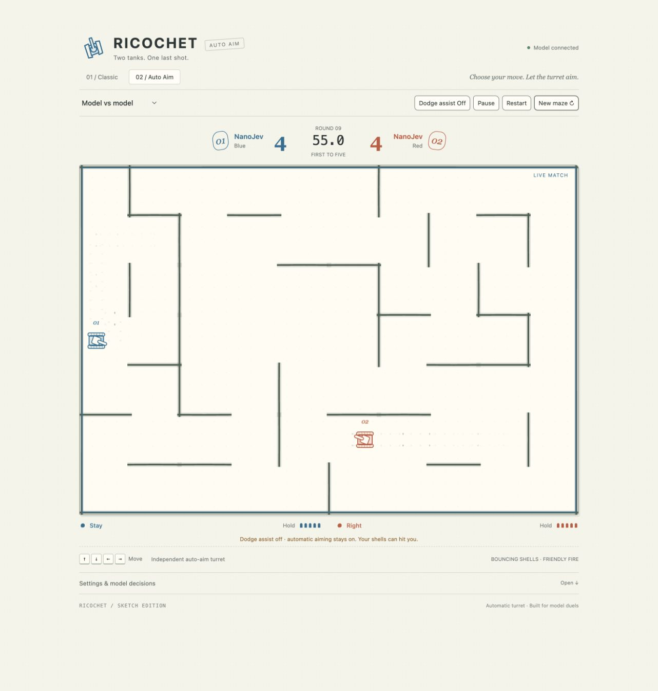

# RICOCHET

Two tanks. One last shot. Two browser games in one English sketchbook UI,
with local keyboard play and an optional Honing model connection.

| Edition      | Movement                                    | Aiming and firing                                                                                                     |
| ------------ | ------------------------------------------- | --------------------------------------------------------------------------------------------------------------------- |
| **Classic**  | Forward/reverse; left/right rotate the hull | Barrel follows the hull. Planned steering chooses a joint motion, then asks the model whether to fire after turning.  |
| **Auto Aim** | Up/down/left/right in screen coordinates    | Independent turret turns toward a verified direct or ricochet shot. The model chooses movement and firing separately. |

Both have bouncing shells, five active shells per tank, one-hit rounds, a
first-to-five match, seeded mazes, model probabilities, full context inspection,
and downloadable match records. **Your own shells are lethal.**

Screenshots from connected model matches; model labels come from the configured service.

| Classic                      | Auto Aim                       |
| ---------------------------- | ------------------------------ |
|  |  |

## Play now

Requires Node.js 22 or newer. No build, Python, GPU, game assets or runtime npm
dependencies are needed for local play.

```bash
cd integrations/tank-duel
npm start
```

Open <http://127.0.0.1:4177/> and choose an edition. Direct links:

- <http://127.0.0.1:4177/classic/>
- <http://127.0.0.1:4177/auto-aim/>

Blue uses WASD + Space; Red uses arrow keys + Enter. In Classic, W/S drive and
A/D turn. In Auto Aim, WASD move in screen coordinates. P pauses; backgrounding
the tab also pauses the game. A keyboard is required; the layout scales to
small screens for viewing, but there are no touch controls.

The collapsed **Settings & model decisions** panel contains model selection,
50–1,000 ms scheduling, trajectory previews, fullscreen, context and match
export. The main arena stays clear for demos and recordings.

## Connect a model

Start a [Honing decision server](../../honing/backends/jev/server.py), then set
its **base URL** when launching the game server:

```bash
HONING_URL=http://127.0.0.1:8080 MODEL_LABEL=NanoJev npm start
```

This enables **Model vs model** and **You vs model** in both editions. The game
uses `GET /v1/health` and `POST /v1/decide`; the loaded backend must support
choice questions and return complete native probability distributions. The
bridge accepts the existing Laya, Kev and NanoJev decision contract. Additional
families, including a djev/DiffusionGemma backend, can use the same interface
when available in the configured Honing server. This demo does not install,
download, load or pin model weights, or change any backend implementation.

Use the model server's documented setup to prepare its checkpoint, pins and
GPU. Allow enough context for the full maze, all ten shells and every offered
choice; the bridge reports an error if that complete state cannot fit. `HONING_TOKEN`, when set, adds a server-side Bearer header for an upstream
proxy that requires it. It is never returned to the browser. The game server
does not accept upstream URLs or credentials from browser requests.

To use a configuration file, copy `.env.example` to `.env`, edit it, then run:

```bash
node --env-file=.env server.mjs
```

`npm start` reads the process environment; it does not load `.env` implicitly.
`PORT` defaults to 4177 and `HOST` to `127.0.0.1`. `DEFAULT_EDITION=classic` or
`auto-aim` redirects the home route. For an HTTPS reverse proxy, set
`PUBLIC_ORIGIN` to its exact external origin. This is a local demo server;
shared deployments should put their usual authentication and rate limits in
front of it. The static `web/` directory can also be served by any HTTP server;
without the game API it offers keyboard play only.

Existing tank-specific services can be retained using `CLASSIC_MODEL_URL`,
`CLASSIC_MODEL_LABEL`, `AUTOAIM_MODEL_URL` and `AUTOAIM_MODEL_LABEL`. These use
`/health` and `/decision` directly. `CLASSIC_NANOJEV_URL` adds a second Classic
backend. Each service must report its model, two seat IDs and the appropriate
protocols: `plans-v1` plus `controls-v3` for Classic, `controls-v2` for Auto Aim.
Responses must echo the request ID, round, seat, model and protocol, include
native probabilities and report `state_truncated: false`.

## What the model sees and controls

- Both editions include **every active shell from both players**: position,
  velocity, owner, ricochet count and remaining lifetime. Ownership never makes
  a shell safe. State also includes tank positions, ammo, cooldowns and time.
- Classic adds hull heading, wall geometry, verified hit directions, required
  turns, response-delay estimates, navigation waypoints and forecasts for all
  nine drive/turn combinations. Auto Aim supplies forecasts for each usable
  movement, including whole-path shell clearance and enemy-route progress.
- The model's essential state is sent intact. The bridge rejects missing
  candidates, invalid probabilities, mismatched responses and truncated state.
  It does not invent probabilities or substitute a scripted player on errors.
- Each seat has its own request/context and at most one request in flight.
  A shared endpoint may serialize both seats on the same model weights;
  independent seats do **not** imply separate model instances or GPUs.
- **50 ms is a scheduling floor, not an inference latency promise.** The UI
  reports request cadence and round-trip latency. Late decisions over 1.6 s
  are discarded; disconnects pause the match. Movement continues during
  inference until the current command expires.

Classic's default **Planned steering** is explicitly model + geometry assistance:
all nine native motion probabilities are retained, selection is restricted to
the geometrically admissible plans, then a second model request evaluates the
weapon conditioned on that exact motion. The hull turns at its physical speed.
If fresh geometry changes the motion or invalidates the shot, firing is
cancelled. Displayed drive/turn probabilities are marginals of the joint motion
distribution. **Raw controls** exposes independent drive/turn/fire choices for
experiments and can cause self-hits.

Classic's default **Light** dodge checks every 120 ms, reacts only to predicted
hits within 300 ms, intervenes for at most 200 ms, then cools down for 750 ms.
Standard and Strong remain available. Auto Aim's separate optional dodge checks
700 ms ahead every 50 ms and defaults **off**. Dodge assistance never controls
keyboard players. All interventions appear in match exports.

The export records model metadata, seed, physics revision, context, native
responses, actual latency, applied plans, shots, kills and assistance events.
It is an audit record, not a deterministic replay format. Treat probability
bars as model outputs; geometry restrictions and execution changes are shown
separately in the details and export.

## Collision rules

The complete tank silhouette, tracks and barrel fit inside a shared **22 px
radius** collision disk. Hull and turret rotations cannot extend into walls.
Wall ink fills the actual wall rectangle. Tanks and shells advance in spatial
steps of at most 2 px, so a delayed frame cannot jump over thin walls or another
live tank. Diagonal movement slides along walls while keeping full clearance.

Forecasts, live physics and displayed geometry use the same dimensions. The
22 px footprint is larger than the earlier experiment's 15 px center-only
collider; old match records are not byte-for-byte comparable. The existing
150 ms owner grace applies only to an unbounced shell leaving its muzzle;
**a bounced own shell is immediately lethal**.

## Verify

```bash
npm ci
npm test
npm run format:check
```

Tests cover both mechanics, self-ricochets, all-shell context, planned rotation
and shot revalidation, bounded assistance, wall/tank collision stress, server
routes, two-seat isolation, Honing request contracts and malformed responses.
CI also runs the real Python `DecisionServer`, the Node bridge and both game
engines against a clearly labelled CPU fixture:

```bash
# From the repository root, with Honing installed in the active Python env:
node scripts/e2e/tank-duel.mjs
```

To check a configured live model with the actual engine and collision assertions:

```bash
node scripts/smoke-model.mjs --edition classic --seconds 25
node scripts/smoke-model.mjs --edition auto-aim --seconds 25
# Optional: --url http://127.0.0.1:4177 --backend honing --controller raw
```

Pause browser model matches before running a smoke check against the same
seats. The smoke check sends real requests and reports model identity, decision
counts, shots, hits and latency; it is a connectivity/gameplay check, not a model
quality benchmark.

## Files

`web/shared/` owns the UI, renderer, model client and collision primitives.
`web/classic/` and `web/auto-aim/` own their engines, context builders and thin UI
adapters. `model-bridge.mjs` maps the game contracts to Honing's typed choice
questions. `server.mjs` serves both editions and forwards configured model calls.
Everything in this directory can be copied as a standalone demo package.
